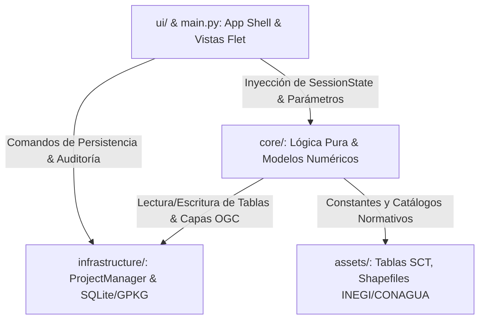

# Arquitectura del Sistema y Catálogo de Elementos (HyDaS v11.2)

> **Documento:** Guía de Arquitectura, Componentes y Contratos de Datos  
> **Sistema:** HyDaS (Hydrological Data Acquisition & Simulation System)  
> **Versión:** 11.2  
> **Entorno de Ejecución:** Python 3.10+ en Conda (`Hydrosistem` / `flet_env`)  

---

## 1. Visión General de la Arquitectura

HyDaS v11.2 está estructurado bajo los principios de **Arquitectura Limpia (Clean Architecture)** y **Puertos y Adaptadores (Hexagonal Architecture)**. El objetivo principal es separar de forma estricta:
1. La **interfaz de usuario reactiva** (Frontend construido con [Flet](https://flet.dev/)).
2. El **motor matemático e hidrológico puro** (Backend algorítmico agnóstico a la UI).
3. La **capa de infraestructura y persistencia geoespacial** (Gestor de base de datos `.hds` sobre SQLite / GeoPackage).



### Principios Fundamentales de Diseño
- **Independencia de la Interfaz:** Ninguna función dentro del directorio `core/` debe importar `flet` ni manipular controles visuales. Toda la comunicación de resultados se realiza mediante diccionarios puros, tipos de datos nativos, `pandas.DataFrame` o estructuras Pydantic.
- **Aislamiento de Persistencia:** Las vistas y algoritmos interactúan con el disco a través de la interfaz unificada de [project_manager.py](file:///c:/Users/USER/Documents/proyectos/conda/CONAGUA-Completando_Datos/Version11.2/infrastructure/project_manager.py), evitando accesos directos desordenados con `open()` o rutas relativas no resueltas.
- **Tolerancia a Fallos en Runtime de Windows:** Resolución explícita de variables de entorno para librerías C/C++ vinculadas (`PROJ_LIB`, `GDAL_DATA`, `GEOS`), mitigando fallos típicos de Proj y GDAL.

---

## 2. Estructura de Directorios del Repositorio

A continuación se detalla la distribución de archivos en el espacio de trabajo:

```text
c:/Users/USER/Documents/proyectos/conda/CONAGUA-Completando_Datos/Version11.2/
├── main.py                       # App Shell, Flet Router, Control de Ciclo de Vida y Protección de Cierre
├── crear_instalador.py           # Constructor automatizado de instalador NSIS para Windows
├── assets/                       # Recursos estáticos, shapefiles oficiales y ambiente Conda
│   ├── environment.yml           # Especificación canónica de dependencias Conda/Pip
│   ├── cuencas.*                 # Shapefiles OGC de cuencas hidrológicas nacionales
│   ├── estados.*                 # Shapefiles de delimitación política (INEGI)
│   ├── icon.ico                  # Iconografía oficial de la aplicación
│   └── tlaloc_egg.gif            # Recursos multimedia de interfaz
├── core/                         # CAPA CORE: Lógica de negocio pura, cálculo numérico e hidrología
│   ├── models.py                 # Esquema relacional ORM (SQLAlchemy)
│   ├── modelos_clima.py          # DTOs y validadores Pydantic para el motor Chen/Clima
│   ├── modelos_espaciales.py     # Contratos de datos geoespaciales
│   ├── hidrologia_mx.py          # Constantes hidrológicas mexicanas (SCT, UNAM, SCS)
│   ├── descarga_logic.py         # Motor de web scraping y geocruce con CONAGUA/SMN
│   ├── imputacion_logic.py       # Algoritmos de interpolación (IDW, MLR, SARIMAX, Kriging)
│   ├── analisis_cuenca.py        # Motor Chen (1983), ajuste probabilístico y curvas IDF
│   ├── Analisis.py               # Módulo de funciones estadísticas y bondad de ajuste
│   ├── analisis_espacial.py      # Operaciones espaciales matriciales y vectoriales
│   ├── arf_logic.py              # Factores de Reducción de Área (ARF) y filtrado estricto C1-C3
│   ├── arf_metodo_comparativa.py # Análisis comparativo multi-método de ARF
│   ├── arf_metodo_diseno.py      # Cálculo de tormentas de diseño con ARF
│   ├── arf_metodo_empirico.py    # Fórmulas empíricas (Horton, Fruhling, NERC)
│   ├── arf_metodo_frecuencias.py # Método de área fija por análisis de frecuencias
│   ├── arf_metodo_unam.py        # Metodología regionalizada del Instituto de Ingeniería UNAM
│   ├── gastos_logic.py           # Tránsito de avenidas, Método Racional, Chow, Hidrograma Unitario y HEC-HMS
│   ├── climatologia_logic.py     # Normales climatológicas y balance hídrico
│   ├── fisica_cuenca.py          # Parámetros morfométricos y tiempos de concentración
│   ├── topologia_acf_logic.py    # Red de drenaje, autocorrelación espacial y morfometría
│   ├── renderizador_espacial.py  # Renderizado de mapas de salida
│   ├── proyecciones_mx.py        # Normalización y estandarización a WGS 84 / UTM Zonas 11N a 16N
│   ├── exceptions.py             # Taxonomía estructurada de excepciones y advertencias de dominio
│   ├── generador_latex.py        # Exportador dinámico de reportes técnicos a LaTeX
│   ├── generador_pdf.py          # Compilador de reportes PDF autónomo
│   └── hpc_engine.py             # Despachador de cálculo concurrente y multi-threading
├── infrastructure/               # CAPA INFRAESTRUCTURA: Persistencia y adaptadores
│   └── project_manager.py        # Motor maestro GeoPackage/SQLite (.hds), serializador LZMA/Parquet
├── ui/                           # CAPA FRONTEND: Interfaz de usuario reactiva en Flet
│   ├── components.py             # Componentes visuales temáticos (MatrixButton, Card, Colors)
│   └── views/                    # Vistas modulares desacopladas
│       ├── welcome_view.py       # Pantalla de bienvenida, selección y creación de proyectos
│       ├── descarga_view.py      # Módulo 1: Extracción y descarga masiva CONAGUA
│       ├── imputacion_view.py    # Módulo 2: Imputación matemática de series climáticas
│       ├── analisis_view.py      # Módulo 3: Análisis de frecuencias extremas y curvas IDF
│       ├── arf_view.py           # Módulo 4: Reducción Areal de Precipitación (ARF)
│       ├── gastos_view.py        # Módulo 5: Tránsito de gastos y modelación de avenidas
│       ├── climatologia_view.py  # Módulo 6: Climatología y balances
│       └── topologia_view.py     # Módulo 7: GIS, topología y modelo físico de cuenca
└── tests/                        # BATERÍA DE CONTROL DE CALIDAD Y NO-REGRESIÓN
    ├── runner.py                 # Ejecutor central de pruebas unitarias
    ├── test_chen_integration.py  # Pruebas del motor Chen e isoyetas SCT
    ├── test_etapas_clima.py      # Pruebas de inferencia Multi-R y persistencia relacional
    ├── test_refactor_fases_1_a_4.py # Validación de fases de arquitectura y serialización
    └── test_temez_y_contratos.py # Vectores críticos de integridad (WAL, Parquet, Témez)
```

---

## 3. Catálogo de Elementos por Capa

### 3.1. Capa de Aplicación y App Shell (`main.py`)
- **[main.py:main()](file:///c:/Users/USER/Documents/proyectos/conda/CONAGUA-Completando_Datos/Version11.2/main.py#L93)**: Función principal que inicializa el contexto de página en Flet, configura el tema visual oscuro, asigna tipografías monoespaciadas y establece el tamaño de ventana (1200x1000).
- **Protección de Cierre del Sistema Operativo (`page.window.prevent_close = True`)**: Bloquea el cierre forzado mediante `_interceptor_cierre_os`. Si la aplicación se encuentra en medio de una operación de guardado atómico o cálculo intensivo, neutraliza el evento de la "X" de Windows hasta concluir el resguardo de la base de datos.
- **Sistema Anti Doble-Clic (`is_navigating`)**: Bandera mutable en memoria que desactiva temporalmente el riel de navegación ([`NavigationRail`](file:///c:/Users/USER/Documents/proyectos/conda/CONAGUA-Completando_Datos/Version11.2/main.py#L340)) y levanta una capa visual de carga (`loading_overlay`) mientras se descargan de memoria los nodos viejos de Flutter y se recolecta la basura mediante `gc.collect()`.
- **Motor de Autoguardado Asíncrono (`trigger_autosave`)**: Hilo de fondo (`threading.Thread(..., daemon=True)`) que extrae las variables del `page.session`, descarta objetos UI de Flet no serializables y consolida los datos en el archivo maestro del proyecto sin bloquear la interfaz.

---

### 3.2. Capa de Infraestructura (`infrastructure/`)

#### [`infrastructure/project_manager.py`](file:///c:/Users/USER/Documents/proyectos/conda/CONAGUA-Completando_Datos/Version11.2/infrastructure/project_manager.py)
Contiene la clase central [`GeoProjectManager`](file:///c:/Users/USER/Documents/proyectos/conda/CONAGUA-Completando_Datos/Version11.2/infrastructure/project_manager.py#L49), diseñada bajo el patrón Singleton accesible mediante la instancia global `project_manager_instance`.
- **Formato `.hds`**: Archivo compuesto que opera como una base de datos SQLite estándar cumpliendo con la especificación OGC GeoPackage.
- **Configuración de SQLite**:
  - `PRAGMA journal_mode=WAL`: Permite múltiples lectores concurrentes mientras se realiza escritura sin bloquear el motor.
  - `PRAGMA synchronous=NORMAL`: Reduce la latencia de sincronización con disco manteniendo seguridad contra caídas de energía.
  - `PRAGMA busy_timeout=10000`: Espera hasta 10 segundos antes de lanzar excepciones por bloqueo de archivo en Windows.
- **Serialización Recursiva Universal (`pack_tree` / `unpack_tree`)**:
  - Transforma cualquier estructura anidada arbitraria (árboles de diccionarios, listas, arrays de numpy) en estructuras JSON-safe.
  - Los `pandas.DataFrame` y `pandas.Series` son empaquetados en búferes de memoria en formato binario Apache Parquet mediante `pyarrow` y codificados en Base64.
  - Elimina el error crítico `<NonSerializable: DataFrame>` y erradica los archivos temporales huérfanos en `%TEMP%`.
- **Auditoría Transaccional (`registrar_auditoria`)**: Escribe eventos en la tabla `hidro_audit_log` con marca temporal en UTC, módulo emisor, acción y usuario.

---

### 3.3. Capa de Modelado de Datos (`core/models.py` y `core/modelos_clima.py`)

#### Tablas ORM de Persistencia ([`core/models.py`](file:///c:/Users/USER/Documents/proyectos/conda/CONAGUA-Completando_Datos/Version11.2/core/models.py))
1. **`hidro_proyecto`**: Metadatos de cabecera (ID UUIDv4, nombre, autor, fecha de creación, EPSG del sistema de referencia por defecto `32614`, versión de esquema `11.2`, y bandera `session_activa` para detección de caídas anómalas).
2. **`hidro_estaciones`**: Registro maestro de estaciones climatológicas (ID CONAGUA, nombre, latitud, longitud, altitud, estado objetivo).
3. **`hidro_session_state`**: Almacén clave-valor de tensores serializados. Contiene columnas `key` (PK), `data_type` ('json', 'parquet', 'bytes', 'folder_backup') y `blob_data` (contenido binario).
4. **`hidro_audit_log`**: Historial append-only de modificaciones y eventos de guardado.

#### DTOs de Validación ([`core/modelos_clima.py`](file:///c:/Users/USER/Documents/proyectos/conda/CONAGUA-Completando_Datos/Version11.2/core/modelos_clima.py))
- **`EntradaDescriptoresChen`**: Contrato estricto para cálculo de lluvia máxima en 1 hora. Valida límites matemáticos para duraciones y periodos de retorno.
- **`ResultadoDescriptoresChen`**: Encapsula descriptores calculados ($R$, $F$, $P_1^{10}$, etc.) garantizando acotamiento numérico estricto ($0.10 \le R \le 0.699$).

---

### 3.4. Capa de Lógica Pura y Algoritmos (`core/`)

| Archivo / Módulo | Propósito y Algoritmos Principales |
| :--- | :--- |
| **`descarga_logic.py`** | Scraping robusto de bases de datos del SMN/CONAGUA, normalización heurística de nombres de estados con soporte para discrepancias INEGI, geocruce espacial con shapefiles de cuencas mediante `shapely` y `geopandas`, descarga concurrente en lotes mediante `ThreadPoolExecutor`. |
| **`imputacion_logic.py`** | Interpolación de series temporales de precipitación y temperatura. Métodos implementados: IDW (Ponderación Inversa a la Distancia), Regresión Lineal Múltiple (MLR), Modelos autorregresivos SARIMAX con `pmdarima`, Polígonos de Thiessen espaciales (`shapely.ops.voronoi_diagram`). |
| **`analisis_cuenca.py`** | Ajuste de funciones de distribución de probabilidad para valores extremos (Gumbel, Log-Pearson Tipo III, Normal, Log-Normal). Implementación del algoritmo de Chen (1983) para derivación de lluvias horarias a partir de lluvias diarias ($P_{24}^T$), cálculo de factores de reducción y construcción de Curvas IDF (Intensidad-Duración-Periodo de Retorno). |
| **`arf_logic.py`** | Orquestación de Factores de Reducción de Área (Areal Reduction Factors). Motor de filtrado estricto C1 (sin datos de vecinos), C2 (menos de 5 vecinos válidos) y C3 (valores que superan el máximo histórico regional semanal). Cálculo de continuidad temporal e integración con SQLite GeoPackage. |
| **`gastos_logic.py`** | Hidrología superficial de diseño. Métodos de cálculo de caudal pico: Método Racional Clásico, Conmutación de Témez (con factor de reducción por área $K_A$), Método de Chow, e Hidrograma Unitario Triangular del SCS. Generación de hietogramas de diseño con curvas SCS Tipo II / III y Bloques Alternos. Simulación distribuida con multi-threading. |
| **`topologia_acf_logic.py`** | Análisis morfométrico de cuencas hidrográficas: área, perímetro, factor de compacidad de Gravelius, coeficiente de forma y densidad de drenaje a partir de capas vectoriales. |
| **`climatologia_logic.py`** | Estimación de normales climatológicas mensuales y anuales, índices de aridez, evaporación potencial y balances hídricos superficiales. |
| **`proyecciones_mx.py`** | Aduana geoespacial de estandarización obligatoria a WGS 84 / UTM Zonas 11N a 16N de México (EPSG:32611 a 32616), inferencia analítica por longitud de centroide y prevención de distorsión métrica en áreas de cuenca. |
| **`exceptions.py`** | Taxonomía jerárquica de excepciones estructuradas del dominio (`ClimaDataError`, `NonMonotonicIDRError`, `SpatialCRSError`, `PersistenceError`) con códigos de diagnóstico y sugerencias de remediación. |
| **`hidrologia_mx.py`** | Tablas maestras oficiales de la normativa mexicana: Coeficientes de escurrimiento $C$ de la SICT/CONAGUA, números de curva $N$ del SCS según uso de suelo y tipo hidrológico, y coeficientes regionales. |

---

### 3.5. Capa de Vistas de Usuario (`ui/views/`)

Las 8 pantallas del sistema son inyectadas dinámicamente en el contenedor central de `main.py` mediante el patrón Builder:

1. **`welcome_view.py`**: Selección de espacio de trabajo, creación de nuevos proyectos `.hds` y apertura segura con validación de integridad previa.
2. **`descarga_view.py`**: Interfaz de selección geoespacial por estado/cuenca, filtros temporales e inicio de tareas de scraping concurrente.
3. **`imputacion_view.py`**: Tablero de selección de métodos de imputación, visualización de matrices de correlación y mapas de Thiessen integrados en WebView.
4. **`analisis_view.py`**: Configuración de análisis de frecuencias, pruebas de bondad de ajuste (Kolmogorov-Smirnov, Chi-cuadrada), conmutador de método Chen (R regional vs. Isoyetas SCT) y visualizador interactivo de curvas IDF.
5. **`arf_view.py`**: Módulo avanzado de reducción espacial de lluvia. Comparación visual de tormentas puntuales vs. areales en cuencas de gran escala.
6. **`gastos_view.py`**: Modelación hidrológica completa, configuración de tiempos de concentración, selección de hietogramas y visualización de hidrogramas resultantes con exportación tabular.
7. **`climatologia_view.py`**: Cuadros climáticos resumen, histogramas de precipitación y generación de reportes ejecutivos.
8. **`topologia_view.py`**: Inspección y validación de geometrías vectoriales de la cuenca y cauce principal, métricas morfométricas y compatibilidad OGC.

---

## 4. Contratos de Datos y Tipos entre Capas

Para garantizar la estabilidad y evitar roturas entre interfaces al modificar el código, se establecen los siguientes contratos de tipos:

### Formato de Índices en DataFrames de Lluvia y Curvas IDF
- **Índice de Duraciones (`df_intensidad`, `df_altura`)**:
  - `index.name`: Obligatoriamente `DURACION_MIN`.
  - `index.dtype`: Obligatoriamente `numpy.float64` (valores típicos: 5.0, 10.0, 15.0, 30.0, 60.0, 120.0, 360.0, 720.0, 1440.0).
- **Columnas de Periodos de Retorno ($T_r$)**:
  - Nombres numéricos enteros o cadenas numéricas (ej. `2`, `5`, `10`, `25`, `50`, `100`, `500`).
  - Valores numéricos: Tasas de lluvia estrictamente positivas en $mm/h$ o alturas en $mm$.

### Estructura de Diccionario de Descriptores Chen (`descriptores_chen`)
```python
{
    "station_id": str,          # Identificador de la estación analizada
    "distribucion": str,        # Nombre de la distribución adoptada (ej. 'Gumbel', 'Log Pearson III')
    "metodo_r": str,            # 'r_regional' o 'isoyetas_sct'
    "r_acotado": float,         # Ratio 1h / 24h acotado en el intervalo [0.10, 0.699]
    "f_calculado": float,       # Factor de lluvia de 1h y 10 años / 24h y 10 años (> 1.0)
    "p1_10_mm": float,          # Precipitación máxima de 1 hora para Tr=10 años (mm)
    "p1_25_mm": float,          # Precipitación máxima de 1 hora para Tr=25 años (mm)
    "p1_50_mm": float,          # Precipitación máxima de 1 hora para Tr=50 años (mm)
    "weiss_aplicado": bool      # Indica si se multiplicó por 1.13 para convertir lluvia diaria fija a 24h continuas
}
```

### Tabla de Descriptores Chen en SQLite GeoPackage (`estacion_descriptores_chen`)
Cualquier módulo que consuma o almacene descriptores de lluvia debe ceñirse a la estructura DDL:
```sql
CREATE TABLE IF NOT EXISTS estacion_descriptores_chen (
    station_id TEXT PRIMARY KEY,
    distribucion TEXT NOT NULL,
    metodo_r TEXT NOT NULL,
    p1_10 REAL NOT NULL,
    p1_25 REAL NOT NULL,
    p1_50 REAL NOT NULL,
    r_calculado REAL NOT NULL,
    r_acotado REAL NOT NULL,
    f_calculado REAL NOT NULL,
    p24_10 REAL NOT NULL,
    factor_weiss REAL DEFAULT 1.13,
    fecha_calculo TEXT NOT NULL
);
```
