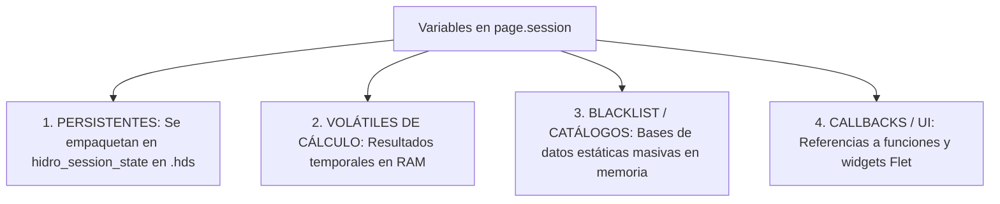

# Diccionario Canónico de Claves de Sesión (State Dictionary - HyDaS v11.2)

> **Documento:** Catálogo Formal de Variables de Sesión (`page.session`), Ciclo de Vida y Tipado  
> **Sistema:** HyDaS (Hydrological Data Acquisition & Simulation System)  
> **Versión:** 11.2  

---

## 1. Clasificación del Ciclo de Vida de Variables

Para evitar corrupción de datos, sobrecarga de memoria y errores de serialización, toda variable almacenada en el diccionario reactivo de Flet (`page.session`) pertenece a una de las siguientes cuatro categorías:



1. **PERSISTENTES (Persist in `.hds`):**  
   Tensores matemáticos, DataFrames de curvas IDF, escenarios de cálculo y descriptores del proyecto. Se serializan recursivamente mediante Parquet y Base64 al dispararse el autoguardado o al guardar manualmente.
2. **VOLÁTILES DE CÁLCULO (Transient In-Memory):**  
   Archivos intermedios, rutas a HTMLs temporales de mapas o estados de visualización de gráficos.
3. **BLACKLIST / CATÁLOGOS MASIVOS (Excluidos de `.hds`):**  
   Catálogos nacionales de CONAGUA precargados para visualización rápida. Se excluyen deliberadamente para no hacer que el archivo `.hds` pase de unos pocos megabytes a gigabytes de información redundante.
4. **CALLBACKS Y CONTROLES FLET (Excluidos de Serialización):**  
   Funciones ejecutables (`callable`) y controles visuales (`ft.Control`). El motor `_extract_serializable_session()` los descarta dinámicamente antes de escribir en disco.

---

## 2. Inventario Maestro de Variables de Sesión

### 2.1. Gestión Global del Proyecto y Navegación
| Clave de Sesión | Tipo de Dato | Categoría | Origen | Módulos Consumidores | Descripción Técnica |
| :--- | :--- | :--- | :--- | :--- | :--- |
| `current_project_path` | `str` | Persistente | `welcome_view` | Todos (1 - 7) | Ruta absoluta en disco del archivo `.hds` actualmente abierto. |
| `last_nav_index` | `int` | Volátil | `main.py` | `main.py` | Índice del último módulo visitado en el `NavigationRail` (0 a 6). |
| `navigate_to_module` | `callable` | Callback | `main.py` | Vistas 1 - 7 | Función segura para saltar de un módulo a otro con autoguardado. |
| `trigger_autosave` | `callable` | Callback | `main.py` | Vistas 1 - 7 | Disparador de autoguardado en segundo plano (`threading.Thread`). |
| `trigger_exit_dialog` | `callable` | Callback | `main.py` | Shell | Función de cierre controlado al pulsar la "X" de Windows. |
| `main_rail` | `ft.NavigationRail`| Control UI | `main.py` | Shell | Referencia al menú lateral para bloqueo durante cargas. |

---

### 2.2. Módulo 1: Extracción y Descarga Masiva
| Clave de Sesión | Tipo de Dato | Categoría | Origen | Módulos Consumidores | Descripción Técnica |
| :--- | :--- | :--- | :--- | :--- | :--- |
| `local_stations_folder` | `str` | Volátil | `descarga_view` | M1, M2 | Ruta a la carpeta que contiene los archivos crudos `.txt` descargados. |
| `catalogo_conagua` | `dict` | Blacklist | `descarga_view` | M1 | Diccionario nacional con claves de estados y estaciones del SMN. |
| `df_estaciones_nacionales` | `pd.DataFrame` | Blacklist | `descarga_view` | M1 | DataFrame maestro de estaciones oficiales activas e inactivas. |
| `filtro_estado_activo` | `str` | Volátil | `descarga_view` | M1 | Clave del estado federado filtrado (ej. 'nl', 'pue', 'ver'). |

---

### 2.3. Módulo 2: Imputación Matemática de Series
| Clave de Sesión | Tipo de Dato | Categoría | Origen | Módulos Consumidores | Descripción Técnica |
| :--- | :--- | :--- | :--- | :--- | :--- |
| `estaciones_disponibles` | `dict` | Persistente | `imputacion_view` | M2, M3, M4 | Catálogo de estaciones cargadas con latitud, longitud, altitud y archivo. |
| `estacion_objetivo` | `str` | Persistente | `imputacion_view` | M2, M3, M4 | Clave de la estación sobre la cual se enfoca el estudio (ej. 'CNA-19045'). |
| `df_estacion_seleccionada`| `pd.DataFrame` | Volátil | `imputacion_view` | M2 | Serie temporal diaria cruda de la estación seleccionada. |
| `df_imputado` | `pd.DataFrame` | Persistente | `imputacion_view` | M2, M3, M6 | Serie temporal con vacíos interpolados (columnas `ORIGINAL`, `IMPUTADO`). |
| `ruta_mapa_html` | `str` | Volátil | `imputacion_view` | M2 | Ruta temporal al archivo HTML de Folium con marcadores y Voronoi. |

---

### 2.4. Módulo 3: Análisis de Frecuencias y Curvas IDF (Chen)
| Clave de Sesión | Tipo de Dato | Categoría | Origen | Módulos Consumidores | Descripción Técnica |
| :--- | :--- | :--- | :--- | :--- | :--- |
| `df_intensidad` | `pd.DataFrame` | Persistente | `analisis_view` | M3, M5 | Matriz de intensidades ($mm/h$). **Contrato estricto:** `index.name = 'DURACION_MIN'` en `np.float64` y columnas $T_r$. |
| `df_altura` | `pd.DataFrame` | Persistente | `analisis_view` | M3, M5 | Matriz de precipitación acumulada ($mm$) para duraciones y periodos de retorno. |
| `descriptores_chen` | `dict` | Persistente | `analisis_view` | M3, M4, M5 | Diccionario con $R_{\text{acotado}}$, $F$, $P_1^{10}$, $P_1^{25}$, $P_1^{50}$, $P_{24}^{10}$, y flag de Weiss. |
| `metodo_r_activo` | `str` | Persistente | `analisis_view` | M3 | Método adoptado: `'r_regional'` (Campos-Aranda) o `'isoyetas_sct'` (SICT). |
| `distribucion_adoptada` | `str` | Persistente | `analisis_view` | M3, M6 | Modelo de probabilidad seleccionado (`'Gumbel'`, `'Log Pearson III'`). |

---

### 2.5. Módulo 4: Reducción Areal de Precipitación (ARF)
| Clave de Sesión | Tipo de Dato | Categoría | Origen | Módulos Consumidores | Descripción Técnica |
| :--- | :--- | :--- | :--- | :--- | :--- |
| `arf_activo` | `bool` | Persistente | `arf_view` | M4, M5 | **Bandera Conmutadora:** Si es `True`, activa el *Bypass Regional* en el Módulo 5 e inhabilita doble reducción de área. |
| `matriz_tormenta_regional_arf`| `pd.DataFrame` | Persistente | `arf_view` | M5 | Matriz de lluvia regional reducida por factor de área (sustituye a `df_intensidad` local). |
| `factores_arf_calculados` | `dict` | Persistente | `arf_view` | M4 | Factores de reducción calculados por los métodos empírico, frecuencias y UNAM. |
| `df_continuidad_estaciones` | `list[dict]` | Volátil | `arf_view` | M4 | Métricas de lagunas continuas (Gaps) tras purga C1, C2 y C3. |

---

### 2.6. Módulo 5: Tránsito de Gastos e Hidrogramas
| Clave de Sesión | Tipo de Dato | Categoría | Origen | Módulos Consumidores | Descripción Técnica |
| :--- | :--- | :--- | :--- | :--- | :--- |
| `db_escenarios` | `dict` | Persistente | `gastos_view` | M5 | Diccionario anidado de escenarios de modelación. Contiene DataFrames de hietogramas e hidrogramas para cada $T_r$. |
| `escenario_activo` | `str` | Volátil | `gastos_view` | M5 | Nombre o clave del escenario actualmente visible en pantalla. |
| `parametros_cuenca_local` | `dict` | Persistente | `gastos_view` | M5 | Diccionario con área ($km^2$), longitud ($km$), pendiente ($m/m$), $C$ y $N$. |
| `metodo_tc_activo` | `str` | Persistente | `gastos_view` | M5 | Método de tiempo de concentración (`'temez'`, `'kirpich'`, `'california'`, `'giandotti'`). |
| `ka_factor_aplicado` | `float` | Volátil | `gastos_logic` | M5 | Coeficiente reductor de área de Témez (conmuta a $1.0$ si `arf_activo == True`). |

---

### 2.7. Módulo 6: Climatología y Normales
| Clave de Sesión | Tipo de Dato | Categoría | Origen | Módulos Consumidores | Descripción Técnica |
| :--- | :--- | :--- | :--- | :--- | :--- |
| `normales_climatologicas` | `pd.DataFrame` | Persistente | `climatologia_view`| M6 | Tabla de promedios mensuales multianuales de lluvia y temperatura. |
| `balance_hidrico_mensual` | `pd.DataFrame` | Persistente | `climatologia_view`| M6 | Balance de precipitación vs. evaporación potencial estimada. |
| `db_climatologica_masiva` | `pd.DataFrame` | Blacklist | `climatologia_view`| M6 | Repositorio crudo masivo descartado de persistencia en disco. |

---

### 2.8. Módulo 7: GIS / Topología y Modelo Físico
| Clave de Sesión | Tipo de Dato | Categoría | Origen | Módulos Consumidores | Descripción Técnica |
| :--- | :--- | :--- | :--- | :--- | :--- |
| `gdf_cuenca` | `gpd.GeoDataFrame`| Persistente | `topologia_view` | M7, M5 | Capa poligonal de la cuenca estandarizada a WGS84 UTM (Zonas 11N a 16N). |
| `gdf_cauces` | `gpd.GeoDataFrame`| Persistente | `topologia_view` | M7, M5 | Capa lineal de la red hídrica y cauce principal. |
| `zona_utm_detectada` | `dict` | Persistente | `topologia_view` | M7, M5 | Metadatos de proyección: EPSG (32611 a 32616), nombre oficial y longitud de centroide. |
| `metricas_morfometricas` | `dict` | Persistente | `topologia_view` | M7, M5 | Área ($km^2$), perímetro ($km$), factor de Gravelius, forma y densidad de drenaje. |

---

## 3. Guía de Uso para Desarrolladores

### 3.1. Cómo Inyectar una Nueva Clave en `page.session`
Si agrega una nueva variable que debe sobrevivir al cerrar y reabrir el programa:
```python
# 1. Establecer en sesión
page.session.set("mi_nueva_variable", tensor_o_dataframe)

# 2. Si la variable es un DataFrame, asegurarse que no tenga columnas numéricas como tipos object
df_limpio = df.copy()
df_limpio.columns = df_limpio.columns.astype(str)
page.session.set("mi_nuevo_dataframe", df_limpio)

# 3. Disparar autoguardado preventivo
trigger_save = page.session.get("trigger_autosave")
if trigger_save:
    trigger_save(silent=True, modulo_origen="Mi_Modulo")
```

### 3.2. Cómo Declarar una Variable que NO Debe Guardarse en Disco
Si la variable contiene objetos de UI, referencias a controladores o estructuras gigantes de lectura única:
1. Agréguela a la lista `BLACKLIST_KEYS` en [`main.py`](file:///c:/Users/USER/Documents/proyectos/conda/CONAGUA-Completando_Datos/Version11.2/main.py#L175).
2. O bien, manténgala dentro de variables locales del módulo/control sin registrarla en `page.session`.
