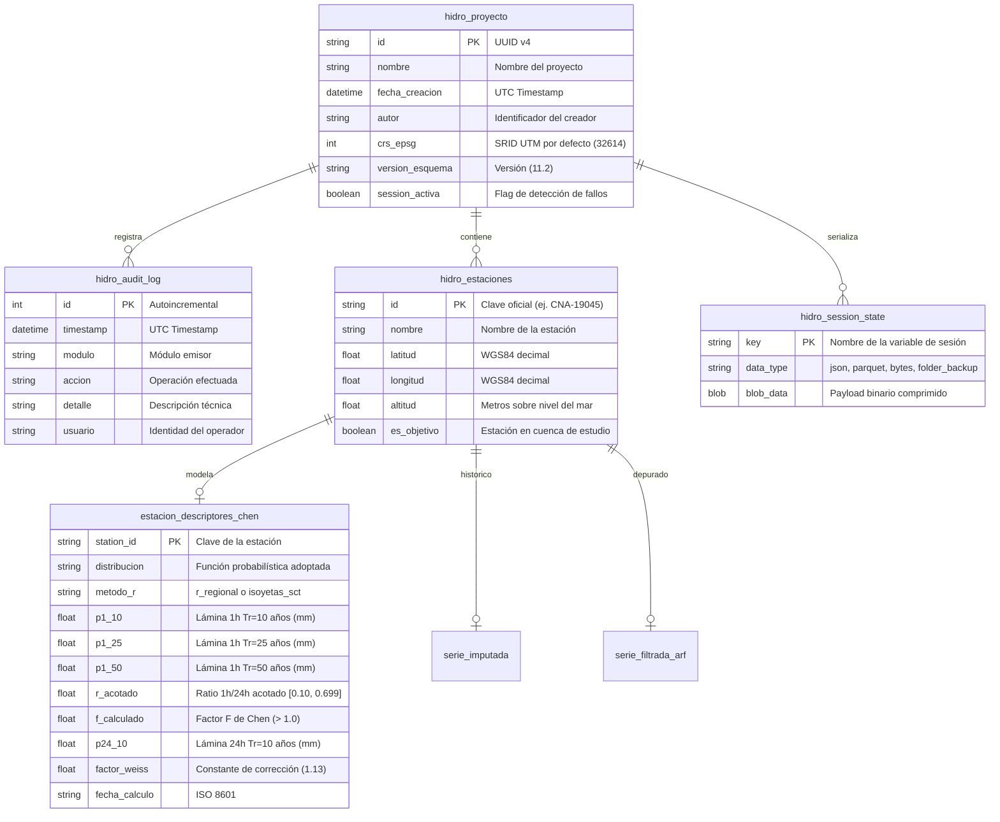

# Especificaciones de Diseño, Estructura y Modelos de Dominio (HyDaS v11.2)

> **Documento:** Especificación Técnica de Patrones, Estructuras de Datos y Normativa Hidrológica  
> **Sistema:** HyDaS (Hydrological Data Acquisition & Simulation System)  
> **Versión:** 11.2  

---

## 1. Patrones de Diseño de Software Aplicados

El desarrollo de HyDaS se rige por patrones de diseño consolidados que evitan acoplamientos rígidos y aseguran la extensibilidad del sistema:

### 1.1. Patrón Singleton (`project_manager_instance`)
- **Ubicación:** [`infrastructure/project_manager.py`](file:///c:/Users/USER/Documents/proyectos/conda/CONAGUA-Completando_Datos/Version11.2/infrastructure/project_manager.py#L49)
- **Propósito:** Mantener una única instancia activa del gestor de persistencia durante todo el ciclo de vida de la aplicación.
- **Implementación:** Al final del módulo se instancia `project_manager_instance = GeoProjectManager()`. Todas las vistas y módulos importan esta instancia única, compartiendo el mismo motor SQLAlchemy (`engine`), sesión local y bloqueo de hilos (`_io_lock = threading.RLock()`).

### 1.2. Patrón Repositorio / Puertos y Adaptadores (Hexagonal)
- **Propósito:** Desacoplar la lógica matemática del almacenamiento físico.
- **Implementación:** La lógica matemática en `core/` no ejecuta queries SQL manuales ni conoce la ruta física de los archivos temporales; interactúa a través de interfaces estandarizadas expuestas por `project_manager_instance` (`save_project`, `load_project`, `guardar_en_sqlite_hds`).

### 1.3. Patrón Estrategia (Strategy Pattern)
- **Distribuciones de Probabilidad:** En [`core/analisis_cuenca.py`](file:///c:/Users/USER/Documents/proyectos/conda/CONAGUA-Completando_Datos/Version11.2/core/analisis_cuenca.py), el cálculo de cuantiles para valores extremos admite múltiples distribuciones (`Gumbel`, `Log Pearson III`, `Normal`, `Log Normal`). Cada algoritmo de ajuste es una estrategia intercambiable que implementa la misma firma de entrada y salida.
- **Métodos de Reducción Areal (ARF):** En [`core/arf_logic.py`](file:///c:/Users/USER/Documents/proyectos/conda/CONAGUA-Completando_Datos/Version11.2/core/arf_logic.py), la reducción espacial se computa mediante estrategias aisladas (`_calculate_empirical_arf`, `_calculate_frequency_arf`, `_calculate_unam_arf`, `_calculate_design_arf`), permitiendo contrastar resultados simultáneamente.
- **Métodos de Caudal Pico:** En [`core/gastos_logic.py`](file:///c:/Users/USER/Documents/proyectos/conda/CONAGUA-Completando_Datos/Version11.2/core/gastos_logic.py), el usuario puede conmutar entre el Método Racional Clásico, Conmutación de Témez, Método de Chow y el Hidrograma Unitario del SCS.

### 1.4. Principio EAFP (Easier to Ask for Forgiveness than Permission)
- **Manejo de UI y Colores en Flet:** Debido a variaciones entre versiones de Flet y Flutter en el renderizado de canales alfa en colores hexadecimales, se utiliza la función `add_opacity(hex_color, opacity)` en [`ui/components.py`](file:///c:/Users/USER/Documents/proyectos/conda/CONAGUA-Completando_Datos/Version11.2/ui/components.py). Intenta manipular el canal nativo y, en caso de excepción, inyecta la máscara de bits hexadecimal directamente sobre el string de color sin interrumpir la ejecución.

---

## 2. Especificación del Formato de Almacenamiento `.hds`

El archivo de extensión `.hds` (Hydrological Data Storage) es el contenedor maestro del proyecto. Físicamente es una **base de datos relacional SQLite 3 certificada como OGC GeoPackage (GPKG)** combinada con serialización binaria comprimida.

### 2.1. Configuración de Motor SQLite (PRAGMAS)
Cada conexión abierta por el gestor de proyectos aplica inmediatamente los siguientes directivas:
```sql
PRAGMA journal_mode = WAL;         -- Habilita Write-Ahead Logging para lecturas no bloqueantes
PRAGMA synchronous = NORMAL;       -- Equilibrio óptimo entre velocidad I/O y tolerancia a caídas
PRAGMA busy_timeout = 10000;       -- Espera hasta 10,000 ms ante bloqueos de archivo en Windows
```

### 2.2. Esquema de Tablas Relacionales Maestras



### 2.3. Serialización Recursiva Universal (`pack_tree` y `unpack_tree`)
Para almacenar variables complejas de la sesión de trabajo sin recurrir a `pickle` (vulnerable a inyecciones de código y con fallos de deserialización entre versiones):
1. **DataFrames y Series:** Se clonan en memoria, se sanean sus índices a tipos compatibles (`str` o `float64`), se serializan como un archivo **Apache Parquet en memoria** con el motor `pyarrow`, y se convierten a cadenas Base64.
2. **Matrices de Numpy (`ndarray`):** Se empaquetan en diccionarios conteniendo la firma tipada de C (`dtype`) y la lista de valores.
3. **Punteros a Archivos de Disco en `%TEMP%`:** Al detectar referencias a cachés temporales, el serializador lee el archivo y absorbe su contenido dentro del árbol JSON para evitar punteros rotos al reiniciar la computadora.
4. **Respaldo de Archivos de Estaciones:** Cuando se importa una carpeta con archivos crudos de CONAGUA (`.txt`), se genera un contenedor ZIP comprimido en memoria (`folder_backup`) almacenado como `BLOB` dentro de `hidro_session_state`.

### 2.4. Estandarización Cartográfica Obligatoria: WGS 84 / Zonas UTM de México (11N a 16N)

Para prevenir distorsiones inadvertidas en el cálculo de áreas de cuenca ($km^2$), longitudes del cauce principal ($L$) y posicionamiento de estaciones pluviométricas, el sistema implementa una **aduana geoespacial estricta** gobernada por [`core/proyecciones_mx.py`](file:///c:/Users/USER/Documents/proyectos/conda/CONAGUA-Completando_Datos/Version11.2/core/proyecciones_mx.py).

#### El Problema de la Distorsión Cartográfica
México abarca territorialmente desde los $118^\circ$ W hasta los $86^\circ$ W. Forzar una única proyección (como UTM 14N) a nivel nacional introduce errores de escala proyectiva inaceptables en los extremos del país (Baja California o la Península de Yucatán), distorsionando los tiempos de concentración ($t_c$) y los caudales punta de diseño ($Q_p$).

#### Catálogo Oficial de Zonas UTM de la República Mexicana
Todas las capas vectoriales (Shapefiles o GeoPackages) ingresadas a HyDaS son normalizadas a la cuadrícula conforme del datum **WGS 84 (EPSG:32611 a 32616)**:

| Zona UTM | Código EPSG | Meridiano Central | Límites Longitud | Cobertura Territorial Mexicana Principal |
| :---: | :---: | :---: | :---: | :--- |
| **Zona 11N** | `EPSG:32611` | $117^\circ$ W | $120^\circ$ W a $114^\circ$ W | Baja California (Tijuana, Mexicali, Ensenada, Tecate, San Quintín). |
| **Zona 12N** | `EPSG:32612` | $111^\circ$ W | $114^\circ$ W a $108^\circ$ W | Sonora, Baja California Sur, Norte de Sinaloa. |
| **Zona 13N** | `EPSG:32613` | $105^\circ$ W | $108^\circ$ W a $102^\circ$ W | Chihuahua, Durango, Sinaloa Sur, Nayarit, Poniente de Jalisco. |
| **Zona 14N** | `EPSG:32614` | $99^\circ$ W | $102^\circ$ W a $96^\circ$ W | Coahuila, Nuevo León, Zacatecas, San Luis Potosí, Guanajuato, Querétaro, Hidalgo, Michoacán, Estado de México, CDMX, Morelos, Tlaxcala, Puebla, Oaxaca Poniente. |
| **Zona 15N** | `EPSG:32615` | $93^\circ$ W | $96^\circ$ W a $90^\circ$ W | Tamaulipas Oriente, Veracruz, Tabasco, Chiapas, Oaxaca Oriente, Campeche Poniente. |
| **Zona 16N** | `EPSG:32616` | $87^\circ$ W | $90^\circ$ W a $84^\circ$ W | Campeche Oriente, Yucatán, Quintana Roo (Cancún, Chetumal, Cozumel). |

#### Algoritmo de Detección y Reproyección Automática
Dada cualquier geometría vectorial cargada en el sistema:
1. **Sanación:** Se ejecuta `geom.buffer(0)` para reparar auto-intersecciones o geometrías no cerradas.
2. **Cálculo del Centroide:** Si la capa carece de CRS o está en coordenadas proyectadas de otra región, se transforma a coordenadas geográficas WGS84 (`EPSG:4326`) y se computa el centroide medio $(\text{lon}_c, \text{lat}_c)$.
3. **Inferencia Analítica:**
   $$Z_{\text{UTM}} = \left\lfloor \frac{\text{lon}_c + 180^\circ}{6^\circ} \right\rfloor + 1 \quad (\text{acotado estrictamente en } [11, 16])$$
   $$\text{EPSG}_{\text{destino}} = 32600 + Z_{\text{UTM}}$$
4. **Reproyección Planar y Advertencia:** Se ejecuta `gdf.to_crs(epsg=EPSG_destino)`. Si el CRS de origen difería del óptimo, el sistema emite la advertencia formal `SpatialCRSMismatchWarning`, informando al usuario la transformación efectuada y garantizando que el cálculo de área en metros cuadrados (`geom.area / 1e6`) sea métricamente fidedigno.

---

## 3. Especificaciones y Fórmulas de Ingeniería Hidrológica

HyDaS v11.2 incorpora los criterios y estándares normativos dictados por la Comisión Nacional del Agua (CONAGUA), la Secretaría de Infraestructura, Comunicaciones y Transportes (SICT) y el Instituto de Ingeniería de la UNAM (II-UNAM).

### 3.1. Ajuste de Funciones de Probabilidad para Valores Extremos
Las series de precipitación máxima diaria anual ($P_{24}$) se analizan mediante los siguientes modelos estadísticos:

- **Distribución Gumbel (Valores Extremos Tipo I):**
  $$F(x) = \exp\left(-\exp\left(-\frac{x - u}{\alpha}\right)\right)$$
  Parámetros estimados por momentos: $\alpha = \frac{\sqrt{6}}{\pi} S_x$, $u = \bar{x} - 0.5772 \alpha$.
  
- **Distribución Log-Pearson Tipo III (LP3):**
  Se transforman las variables a espacio logarítmico $y = \log_{10}(x)$. Se calcula la media $\bar{y}$, la desviación estándar $S_y$ y el coeficiente de asimetría $C_s$. El cuantil para periodo de retorno $T_r$ se obtiene mediante el factor de frecuencia $K(T_r, C_s)$:
  $$y_{Tr} = \bar{y} + K(T_r, C_s) \cdot S_y \quad \implies \quad x_{Tr} = 10^{y_{Tr}}$$

### 3.2. Formulación de Chen (1983) para Derivación de Lluvias Cortas
Para obtener la precipitación correspondiente a duraciones cortas ($t \le 1440$ min) a partir de lluvia diaria:

$$P_t^T = \frac{P_1^{10} \cdot \log_{10}(10^{2 - x} \cdot T^{x - 1}) \cdot t}{(t + b)^c}$$

Donde:
- $P_1^{10}$ es la precipitación máxima en 1 hora para un periodo de retorno de 10 años ($mm$).
- $R$ es la relación entre la lluvia de 1 hora y 24 horas para $T_r = 10$ años:
  $$R = \frac{P_1^{10}}{P_{24}^{10}}$$
- Los coeficientes $a$, $b$ y $c$ se derivan empíricamente a partir del valor de $R$:
  $$a = 0.5 \cdot (1 - R)^{-0.9}$$
  $$b = 20 \cdot (1 - R)^{0.5}$$
  $$c = 0.6 \cdot (1 - R)^{0.2}$$
- **Factor de Weiss (1.13):** Debido a que los pluviómetros de CONAGUA leen acumulados en horarios fijos (8:00 AM a 8:00 AM del día siguiente), la verdadera lluvia máxima continua en cualquier lapso de 24 horas es subestimada. El sistema aplica por defecto el factor empírico de Weiss:
  $$P_{24,\text{continuo}} = 1.13 \cdot P_{24,\text{fijo}}$$
- **Acotamiento Físico de $R$ (Clamping Defensivo):**
  En zonas hiper-áridas o con datos atípicos, $R$ puede dar valores físicamente imposibles. El código restringe forzosamente:
  $$0.10 \le R_{\text{acotado}} \le 0.699$$

### 3.3. Tiempos de Concentración de la Cuenca ($t_c$)
Se implementan 4 formulaciones de referencia en [`core/gastos_logic.py`](file:///c:/Users/USER/Documents/proyectos/conda/CONAGUA-Completando_Datos/Version11.2/core/gastos_logic.py) y [`core/fisica_cuenca.py`](file:///c:/Users/USER/Documents/proyectos/conda/CONAGUA-Completando_Datos/Version11.2/core/fisica_cuenca.py):

| Método | Fórmula Matemática | Unidades y Parámetros |
| :--- | :--- | :--- |
| **Témez (España / SICT)** | $t_c = 0.3 \cdot \left(\frac{L}{S^{0.25}}\right)^{0.76}$ | $t_c$ en horas; $L$ longitud del cauce en $km$; $S$ pendiente media en $m/m$. |
| **Kirpich (SCS)** | $t_c = 0.0663 \cdot \left(\frac{L}{\sqrt{S}}\right)^{0.77}$ | $t_c$ en horas; $L$ en $km$; $S$ en $m/m$. Adecuado para cuencas agrícolas e inclinadas. |
| **California Culverts Practice** | $t_c = \left(\frac{11.9 \cdot L^3}{H}\right)^{0.385}$ | $t_c$ en horas; $L$ en $km$; $H$ desnivel total entre inicio y fin en $m$. |
| **Giandotti (Italia)** | $t_c = \frac{4 \sqrt{A} + 1.5 L}{0.8 \sqrt{H}}$ | $t_c$ en horas; $A$ área de la cuenca en $km^2$; $L$ en $km$; $H$ en $m$. |

---

### 3.4. Métodos de Caudal Máximo y Modelación de Hidrogramas

#### 1. Método Racional Clásico
$$Q_p = 0.278 \cdot C \cdot I(t_c, T_r) \cdot A$$
Donde $Q_p$ es el caudal pico en $m^3/s$, $C$ es el coeficiente de escurrimiento adimensional (catalogo SICT), $I$ es la intensidad de lluvia en $mm/h$ para una duración igual a $t_c$, y $A$ es el área de la cuenca en $km^2$.

#### 2. Conmutación de Témez (Reducción por Superficie Extensa)
Para cuencas donde el área sobrepasa el límite del método racional clásico ($A > 25\text{ km}^2$), se aplica el factor reductor de Témez:
$$Q_p = 0.278 \cdot C \cdot I(t_c, T_r) \cdot A \cdot K_A$$
Donde el coeficiente de reducción de área $K_A$ se calcula:
$$K_A = 1 - \frac{\log_{10}(A)}{15} \quad (\text{para } A \le 3000\text{ km}^2)$$
> **Regla de Integridad de HyDaS:** Si el usuario activa el Módulo 4 (ARF) y ya ha aplicado una reducción regional de tormenta sobre la lluvia, el sistema conmuta automáticamente $K_A = 1.0$ para evitar una **doble penalización** del caudal de diseño.

#### 3. Hidrograma Unitario Triangular del SCS
- **Tiempo al Pico ($t_p$):**
  $$t_p = 0.6 \cdot t_c + \frac{D}{2}$$
  Donde $D$ es el paso de tiempo computacional ($\Delta t$).
- **Gasto Pico Unitario ($q_p$):**
  $$q_p = \frac{0.208 \cdot A \cdot P_e}{t_p}$$
  Donde $P_e$ es la lluvia en exceso o efectiva ($1\text{ mm}$ para unitario).
- **Tiempo Base ($t_b$):**
  $$t_b = 2.67 \cdot t_p$$

#### 4. Hietogramas de Diseño
- **Curvas SCS Tipo II y Tipo III:** Se interpola la función adimensional de masa sobre el horizonte de 24 horas y se discretiza al intervalo de cálculo $\Delta t$, derivando el hietograma incremental por diferencias finitas:
  $$\Delta P_i = P(t_i) - P(t_{i-1})$$
- **Bloques Alternos:** A partir de la curva IDF, se ordenan los incrementos de lluvia colocando el pico máximo en el centro del evento de lluvia ($t = 0.5 \cdot t_{\text{duracion}}$) y alternando los valores decrecientes a izquierda y derecha.
