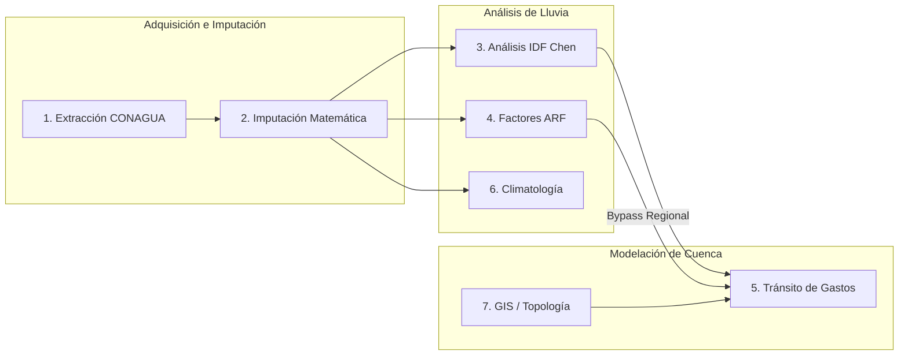

# Índice Maestro de Documentación Técnica de HyDaS v11.2

> **Sistema:** HyDaS (Hydrological Data Acquisition & Simulation System)  
> **Versión:** 11.2  
> **Área:** Ingeniería Hidrológica, Hidrometeorología y Modelación de Cuencas  
> **Marco Tecnológico:** Python 3.10+, Conda (`Hydrosistem`), Flet, SQLite GeoPackage, Apache Parquet  

---

## 🧭 Guía de Navegación del Sistema de Documentación

Esta suite de documentación técnica en formato Markdown ha sido diseñada tanto para desarrolladores e ingenieros humanos como para agentes de inteligencia artificial. Cada documento aborda una dimensión crítica del sistema con especificaciones exhaustivas, contratos formales de datos y diagramas esquemáticos:

| Documento | Enlace | Propósito y Contenido Clave |
| :--- | :--- | :--- |
| **1. Arquitectura y Elementos** | [ARQUITECTURA_Y_ELEMENTOS.md](file:///c:/Users/USER/Documents/proyectos/conda/CONAGUA-Completando_Datos/Version11.2/centro_de_control/ARQUITECTURA_Y_ELEMENTOS.md) | Visión general bajo Arquitectura Limpia y Hexagonal. Catálogo detallado de los 24 módulos en `core/`, persistencia en `infrastructure/`, interfaz reactiva en `ui/`, y contratos estrictos de datos. |
| **2. Especificaciones de Diseño y Estructura** | [ESPECIFICACIONES_DISENO_Y_ESTRUCTURA.md](file:///c:/Users/USER/Documents/proyectos/conda/CONAGUA-Completando_Datos/Version11.2/centro_de_control/ESPECIFICACIONES_DISENO_Y_ESTRUCTURA.md) | Patrones de software (Singleton, Repositorio, Estrategia, EAFP), anatomía del archivo de almacenamiento maestro `.hds` (SQLite/GPKG), y formulaciones hidrológicas normativas (Chen 1983, Weiss 1.13, Témez, Kirpich, SCS, Racional). |
| **3. Políticas y Seguridad** | [POLITICAS_Y_SEGURIDAD.md](file:///c:/Users/USER/Documents/proyectos/conda/CONAGUA-Completando_Datos/Version11.2/centro_de_control/POLITICAS_Y_SEGURIDAD.md) | Estándares DevSecOps, gestión agresiva de memoria (prevención de OOM y fugas GDI de Matplotlib), resiliencia ante bloqueos Windows (`WinError 5` / `WinError 32`), blindaje contra cierre forzado ("Guillotina OS"), política de respaldos `.bak` y prohibición de `pickle`. |
| **4. Pruebas y Control de Calidad** | [PRUEBAS_Y_CONTROL_CALIDAD.md](file:///c:/Users/USER/Documents/proyectos/conda/CONAGUA-Completando_Datos/Version11.2/centro_de_control/PRUEBAS_Y_CONTROL_CALIDAD.md) | Batería automatizada de 21 pruebas unitarias y de integración (`runner.py`), protocolo obligatorio previo a modificar código, matriz de consistencia física ($dI/dt < 0$, $dH/dt > 0$), y plantilla para nuevos tests. |
| **5. Mapa Esquemático de Procesos y Relaciones** | [MAPA_DE_PROCESOS_Y_RELACIONES.md](file:///c:/Users/USER/Documents/proyectos/conda/CONAGUA-Completando_Datos/Version11.2/centro_de_control/MAPA_DE_PROCESOS_Y_RELACIONES.md) | Diagrama de flujo End-to-End, diagramas de secuencia por módulo (del Módulo 1 al 7), variables de sesión consumidas y producidas, matriz de interdependencias cruzadas y recetas paso a paso para modificaciones finas. |
| **6. Diccionario Canónico de Datos de Sesión** | [DICCIONARIO_DATOS_SESION.md](file:///c:/Users/USER/Documents/proyectos/conda/CONAGUA-Completando_Datos/Version11.2/centro_de_control/DICCIONARIO_DATOS_SESION.md) | Inventario formal y tipado de todas las claves de `page.session`, clasificación de ciclo de vida (Persistentes, Volátiles, Blacklist, Callbacks UI) y contratos de datos. |

---

## ⚡ Comandos Rápidos de Operación

### 1. Ejecución de la Suite Completa de Pruebas
```powershell
& "C:\Users\USER\anaconda3\envs\Hydrosistem\python.exe" tests/runner.py
```

### 2. Ejecución de la Aplicación en Modo Desarrollo
```powershell
& "C:\Users\USER\anaconda3\envs\Hydrosistem\python.exe" main.py
```

### 3. Compilación del Ejecutable Standalone (.exe)
```powershell
flet pack main.py --name "HyDaS_v11" --add-data "assets;assets" --hidden-import "pandas" --hidden-import "numpy" --hidden-import "scipy" --hidden-import "scipy.spatial" --hidden-import "scipy.interpolate" --hidden-import "scipy.stats" --hidden-import "statsmodels" --hidden-import "sklearn" --hidden-import "pmdarima" --hidden-import "matplotlib" --hidden-import "matplotlib.backends.backend_agg" --hidden-import "matplotlib.pyplot" --hidden-import "seaborn" --hidden-import "folium" --hidden-import "geopy" --hidden-import "shapefile" --hidden-import "shapely" --hidden-import "tabulate" --hidden-import "requests" --hidden-import "jinja2" --hidden-import "openpyxl" --hidden-import "pyarrow" --icon "assets/icon.ico"
```

### 4. Generación del Instalador Oficial NSIS
```powershell
& "C:\Users\USER\anaconda3\envs\Hydrosistem\python.exe" crear_instalador.py
```

---

## 🗺️ Mapa Conceptual de Módulos


