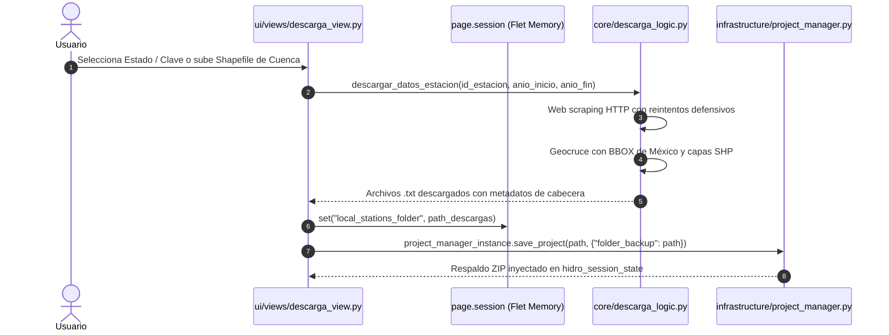
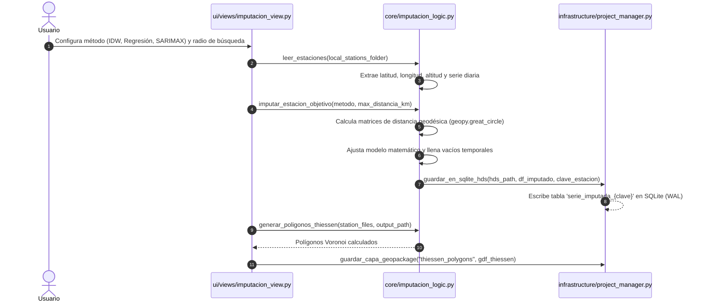
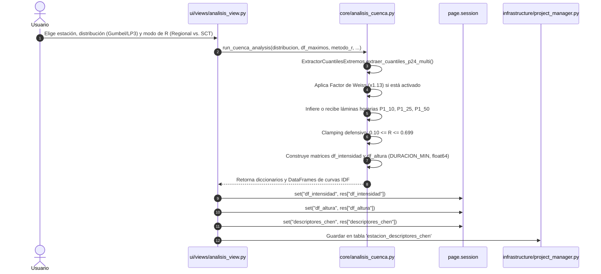
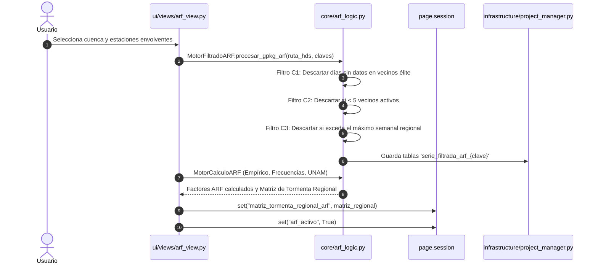
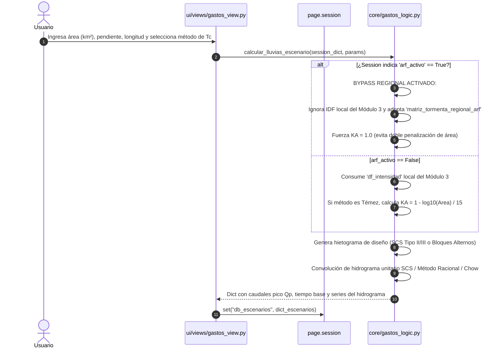

# Mapa Esquemático de Procesos, Flujo de Datos y Relaciones (HyDaS v11.2)

> **Documento:** Ruta Esquemática de Procesos, Pipeline de Datos y Guía de Modificación Fina  
> **Sistema:** HyDaS (Hydrological Data Acquisition & Simulation System)  
> **Versión:** 11.2  

---

## 1. Diagrama Maestro del Pipeline End-to-End

El siguiente esquema ilustra la trayectoria completa de la información desde la captura de datos brutos del Servicio Meteorológico Nacional (SMN) hasta la obtención de hidrogramas de diseño y reportes técnicos:

```mermaid
flowchart TD
    subgraph M1["MÓDULO 1: EXTRACCIÓN (descarga_view / descarga_logic)"]
        A1[Selección de Estado / Cuenca] --> A2[Scraping CONAGUA / SMN Masivo]
        A2 --> A3[Geocruce Espacial con Shapefiles INEGI]
        A3 --> A4[(Archivos TXT de Estaciones en .hds / ZIP)]
    end

    subgraph M2["MÓDULO 2: IMPUTACIÓN (imputacion_view / imputacion_logic)"]
        B1[Lectura de Series Temporales Crudas] --> B2[Detección de Gaps y Vecinos Cercanos]
        B2 --> B3[Interpolación: IDW / MLR / SARIMAX / Thiessen]
        B3 --> B4[(Tabla SQLite: serie_imputada_CLAVE)]
    end

    subgraph M3["MÓDULO 3: ANÁLISIS (analisis_view / analisis_cuenca)"]
        C1[Extracción de Máximos Anuales SAM] --> C2[Ajuste de Probabilidad: Gumbel / LP3]
        C2 --> C3[Derivación Chen 1983 + Factor Weiss 1.13]
        C3 --> C4[Generación de Curvas IDF y PDR]
        C4 --> C5[(Tabla SQLite: estacion_descriptores_chen)]
    end

    subgraph M4["MÓDULO 4: ARF (arf_view / arf_logic)"]
        D1[Purga Estricta de Anomalías C1, C2, C3] --> D2[Análisis de Continuidad y Lagunas]
        D2 --> D3[Cálculo de Reducción: Empírico / Frecuencias / UNAM]
        D3 --> D4[(Tabla SQLite: serie_filtrada_arf_CLAVE)]
        D4 --> D5[Matriz de Tormenta Regional Reducida]
    end

    subgraph M5["MÓDULO 5: GASTOS (gastos_view / gastos_logic)"]
        E1[Parámetros de Cuenca: Área, Longitud, Pendiente] --> E2[Cálculo de Tiempo de Concentración: Témez / Kirpich / California]
        E3{¿Modo ARF Activo?}
        E3 -->|No| E4[Consumir IDF Local del Módulo 3]
        E3 -->|Sí: Bypass Regional| E5[Inyectar Lluvia Regional del Módulo 4 & KA = 1.0]
        E4 --> E6[Generar Hietogramas: SCS Tipo II/III / Bloques Alternos]
        E5 --> E6
        E6 --> E7[Convolución de Caudales: Racional / Chow / Hidrograma Unitario SCS / HEC-HMS]
        E7 --> E8[Hidrogramas de Escurrimiento y Gasto Pico Qp]
    end

    subgraph M6["MÓDULO 6: CLIMATOLOGÍA"]
        F1[Series Imputadas] --> F2[Normales Climatológicas & Balance Hídrico]
        F2 --> F3[Exportación LaTeX / PDF]
    end

    subgraph M7["MÓDULO 7: GIS / TOPOLOGÍA"]
        G1[Shapefile Cuenca / Red Hídrica] --> G2[Morfometría: Gravelius / Forma / Densidad Drenaje]
        G2 --> G3[(Capas OGC GeoPackage en .hds)]
    end

    M1 -->|Datos Crudos| M2
    M2 -->|Series Imputadas| M3
    M2 -->|Series Imputadas| M4
    M2 -->|Series Imputadas| M6
    M3 -->|Curvas IDF Locales| M5
    M4 -->|Bypass Regional ARF| M5
    M7 -->|Parámetros Físicos A, L, S| M5
```



---

## 2. Mapeo Detallado de Procesos por Módulo

A continuación se detalla la anatomía exacta de cada módulo: qué variables lee de la memoria (`page.session`), qué funciones matemáticas invoca en `core/`, y qué resultados produce y almacena.

---

### Módulo 1: Extracción y Descarga Masiva



- **Variables Consumidas de `page.session`:**
  - `current_project_path`: Ruta absoluta del archivo `.hds`.
- **Funciones Principales Invocadas:**
  - [`core.descarga_logic.obtener_clave_estado(nombre_shp)`](file:///c:/Users/USER/Documents/proyectos/conda/CONAGUA-Completando_Datos/Version11.2/core/descarga_logic.py#L56): Normalizador heurístico de nombres.
  - `core.descarga_logic.descargar_estaciones_concurrentes()`: Concurrencia con `ThreadPoolExecutor`.
- **Variables Producidas en `page.session` y BD:**
  - `local_stations_folder`: Ruta temporal al catálogo de estaciones.
  - Tabla `hidro_estaciones`: Inserción de coordenadas y nombres de las estaciones detectadas.

---

### Módulo 2: Imputación de Datos Faltantes



- **Variables Consumidas de `page.session`:**
  - `current_project_path`: Ruta del archivo `.hds`.
  - `local_stations_folder`: Directorio de archivos crudos.
- **Funciones Principales Invocadas:**
  - [`core.imputacion_logic.leer_estaciones()`](file:///c:/Users/USER/Documents/proyectos/conda/CONAGUA-Completando_Datos/Version11.2/core/imputacion_logic.py#L27): Parseo de metadatos de cabecera.
  - `core.imputacion_logic.guardar_en_sqlite_hds()`: Escritura directa y segura en la base de datos relacional.
  - [`core.imputacion_logic.generar_poligonos_thiessen()`](file:///c:/Users/USER/Documents/proyectos/conda/CONAGUA-Completando_Datos/Version11.2/core/imputacion_logic.py#L87): Triangulación de Delaunay / Voronoi.
- **Variables Producidas en BD:**
  - Tabla `serie_imputada_{clave_estacion}`: Contiene columnas `FECHA`, `PRECIP_ORIGINAL`, `PRECIP_IMPUTADO`.
  - Capa GeoPackage `thiessen_polygons`: Polígonos de influencia espacial en formato vectorial OGC.

---

### Módulo 3: Análisis de Frecuencias y Curvas IDF (Método Chen)



- **Variables Consumidas de `page.session`:**
  - Series temporales desde SQLite `serie_imputada_{clave}`.
- **Funciones Principales Invocadas:**
  - [`core.analisis_cuenca.run_cuenca_analysis()`](file:///c:/Users/USER/Documents/proyectos/conda/CONAGUA-Completando_Datos/Version11.2/core/analisis_cuenca.py): Orquestador central de análisis de frecuencias extremas y formulación de Chen.
  - `core.analisis_cuenca.ExtractorCuantilesExtremos`: Ajuste estadístico no paramétrico y paramétrico.
- **Variables Producidas en `page.session` y BD:**
  - `df_intensidad`: Matriz de intensidades ($mm/h$) con índice `DURACION_MIN` (`np.float64`).
  - `df_altura`: Matriz de láminas de lluvia acumulada ($mm$).
  - `descriptores_chen`: Diccionario con $R$, $F$, $P_1^{10}$, etc.
  - Tabla relacional `estacion_descriptores_chen`.

---

### Módulo 4: Reducción Areal de Precipitación (ARF)



- **Variables Consumidas de `page.session`:**
  - `current_project_path`: Base de datos `.hds`.
  - Capas vectoriales de cuenca de estudio.
- **Funciones Principales Invocadas:**
  - [`core.arf_logic.MotorFiltradoARF.filtrar_datos()`](file:///c:/Users/USER/Documents/proyectos/conda/CONAGUA-Completando_Datos/Version11.2/core/arf_logic.py#L22): Purga obligatoria de anomalías.
  - [`core.arf_logic.MotorCalculoARF`](file:///c:/Users/USER/Documents/proyectos/conda/CONAGUA-Completando_Datos/Version11.2/core/arf_logic.py#L181): Cálculo analítico de factores de reducción espacial.
- **Variables Producidas en `page.session` y BD:**
  - Tablas `serie_filtrada_arf_{clave}` en SQLite.
  - `matriz_tormenta_regional_arf`: DataFrame de lluvia regional ajustada por superficie.
  - `arf_activo`: Booleano que activa el *Bypass Regional* en el Módulo 5.

---

### Módulo 5: Tránsito de Gastos e Hidrogramas de Escurrimiento



- **Variables Consumidas de `page.session`:**
  - `df_intensidad` (del Módulo 3) O `matriz_tormenta_regional_arf` (del Módulo 4).
  - `arf_activo`: Bandera conmutadora de bypass regional.
- **Funciones Principales Invocadas:**
  - [`core.gastos_logic.calcular_lluvias_escenario()`](file:///c:/Users/USER/Documents/proyectos/conda/CONAGUA-Completando_Datos/Version11.2/core/gastos_logic.py): Despachador desacoplado para escenarios hidrológicos.
  - [`core.gastos_logic.generar_hietograma_scs()`](file:///c:/Users/USER/Documents/proyectos/conda/CONAGUA-Completando_Datos/Version11.2/core/gastos_logic.py#L49): Discretización dinámica de curvas de masa SCS.
  - `core.gastos_logic.calcular_coeficientes_y_gastos()`: Motor de caudales máximos y convolución.
- **Variables Producidas en `page.session`:**
  - `db_escenarios`: Diccionario anidado con todos los escenarios evaluados (cada uno conteniendo su hidrograma, hietograma, $Q_p$ y balance volumétrico).

---

## 3. Matriz de Dependencias entre Módulos

Esta matriz permite visualizar de un vistazo el impacto de modificar cualquier módulo sobre los demás:

| Módulo Origen | Provee a | Datos / Estructuras Transferidas | ¿Qué ocurre si falla? |
| :--- | :--- | :--- | :--- |
| **M1: Extracción** | M2, M6 | Archivos crudos de estaciones (`.txt`) con cabeceras de coordenadas | M2 y M6 quedan sin insumos de entrada. |
| **M2: Imputación** | M3, M4, M6 | Tablas `serie_imputada_{id}` en SQLite `.hds` | M3 no puede extraer máximos anuales; M4 no puede filtrar anomalías; M6 no puede calcular normales. |
| **M3: Análisis** | M5 | Matriz `df_intensidad` con índice `DURACION_MIN` (`np.float64`) | M5 no puede generar hietogramas locales en modo convencional. |
| **M4: ARF** | M5 | `matriz_tormenta_regional_arf` y bandera `arf_activo` | M5 conmuta automáticamente al modo local clásico (M3). |
| **M7: GIS / Topología** | M5 | Parámetros morfométricos ($A$, $L$, $S$, $H$) | El usuario debe introducir manualmente el área, longitud y pendiente en M5. |

---

## 4. Guía de Modificaciones Finas (Fine-Tuning Architecture)

Para ajustar o extender la arquitectura sin romper el funcionamiento global, siga los patrones establecidos en las siguientes recetas técnicas:

### Receta A: Cómo Agregar una Nueva Distribución Estadística en el Módulo 3
1. **Abrir [`core/analisis_cuenca.py`](file:///c:/Users/USER/Documents/proyectos/conda/CONAGUA-Completando_Datos/Version11.2/core/analisis_cuenca.py).**
2. Localizar la clase `ExtractorCuantilesExtremos`.
3. Agregar el nuevo método estático de ajuste, respetando la firma:
   ```python
   @staticmethod
   def ajustar_mi_distribucion(datos: np.ndarray, periodos_retorno: list) -> dict:
       # Calcular parámetros de la distribución
       # Retornar diccionario {Tr: valor_lluvia}
       return {tr: float(cuantil) for tr, cuantil in zip(periodos_retorno, valores)}
   ```
4. Registrar el nombre en el despachador `extraer_cuantiles_p24_multi(dist_name, datos)`.
5. Ejecutar la batería de pruebas: `& "C:\Users\USER\anaconda3\envs\Hydrosistem\python.exe" tests/runner.py`.

---

### Receta B: Cómo Agregar una Nueva Fórmula de Tiempo de Concentración en el Módulo 5
1. **Abrir [`core/gastos_logic.py`](file:///c:/Users/USER/Documents/proyectos/conda/CONAGUA-Completando_Datos/Version11.2/core/gastos_logic.py).**
2. Crear la función matemática:
   ```python
   def calcular_tc_mi_formula(longitud_km: float, pendiente_m_m: float, area_km2: float) -> float:
       """Calcula Tc en horas mediante la fórmula de Autor (Año)."""
       if longitud_km <= 0 or pendiente_m_m <= 0:
           return 0.1667 # 10 minutos mínimo defensivo
       tc_horas = 0.5 * (longitud_km / (pendiente_m_m ** 0.3)) # Ejemplo
       return float(round(tc_horas, 4))
   ```
3. En la función `calcular_coeficientes_y_gastos()`, agregar la condición en el bloque de selección de método de $t_c$:
   ```python
   elif metodo_tc == "mi_formula":
       tc = calcular_tc_mi_formula(longitud, pendiente, area)
   ```
4. En [`ui/views/gastos_view.py`](file:///c:/Users/USER/Documents/proyectos/conda/CONAGUA-Completando_Datos/Version11.2/ui/views/gastos_view.py), agregar la opción al `ft.Dropdown` de selección de tiempos de concentración.
5. Ejecutar el test de conmutación de Témez en `tests/test_temez_y_contratos.py` para asegurar que el snap-to-grid y los límites inferiores no se rompan.

---

### Receta C: Cómo Añadir una Nueva Tabla Relacional al Contenedor `.hds`
1. **Abrir [`core/models.py`](file:///c:/Users/USER/Documents/proyectos/conda/CONAGUA-Completando_Datos/Version11.2/core/models.py).**
2. Declarar la clase derivada de `Base`:
   ```python
   class MiNuevaTabla(Base):
       __tablename__ = 'hidro_mi_nueva_tabla'
       id = Column(Integer, primary_key=True, autoincrement=True)
       clave_estacion = Column(String, nullable=False)
       parametro = Column(Float, nullable=False)
       fecha_creacion = Column(DateTime, default=lambda: datetime.now(timezone.utc))
   ```
3. En [`infrastructure/project_manager.py`](file:///c:/Users/USER/Documents/proyectos/conda/CONAGUA-Completando_Datos/Version11.2/infrastructure/project_manager.py#L268), `Base.metadata.create_all(bind=self.engine)` creará la tabla automáticamente en todos los nuevos proyectos.
4. Para migrar bases de datos existentes en caliente, agregar un bloque adaptativo DDL:
   ```python
   with self.engine.connect() as conn:
       try:
           conn.execute(text("CREATE TABLE IF NOT EXISTS hidro_mi_nueva_tabla (...);"))
       except Exception:
           pass
   ```
5. Validar con `test_vector_5_ddl_migration_y_winerror5` en `tests/test_temez_y_contratos.py`.
