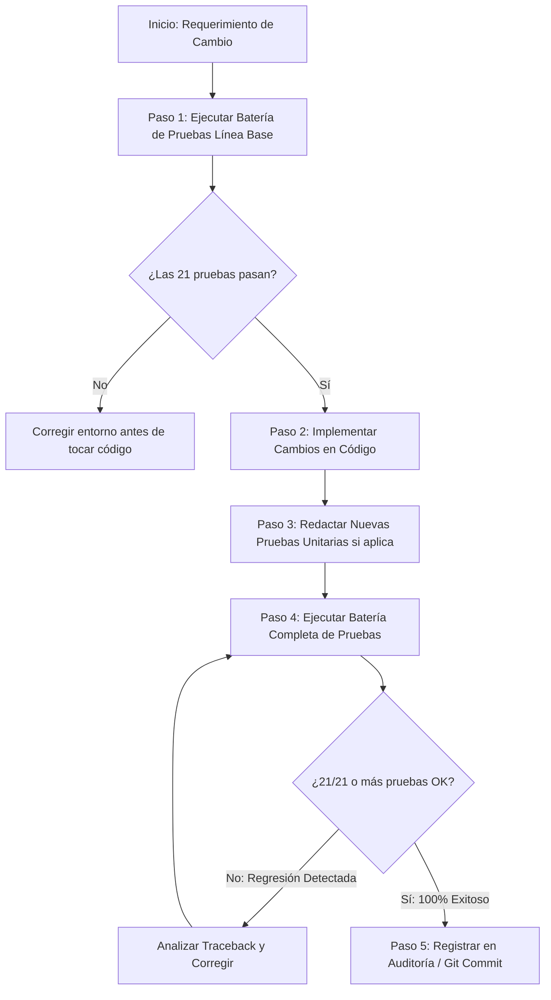

# Guía de Pruebas, Control de Calidad y Validación de Actualizaciones (HyDaS v11.2)

> **Documento:** Marco de Verificación, Batería de Pruebas y Protocolo de No-Regresión  
> **Sistema:** HyDaS (Hydrological Data Acquisition & Simulation System)  
> **Versión:** 11.2  

---

## 1. Filosofía de Calidad y Aseguramiento Técnico

En software de ingeniería hidrológica y modelación de obras hidráulicas (presas, drenajes, cauces), un error de cálculo o una regresión en el código puede derivar en fallas de diseño estructural en el mundo real. 

Por ello, HyDaS v11.2 implementa un **marco de verificación multinivel** compuesto por:
1. **Pruebas de Integridad de Datos e Índices:** Validan que los tipos de datos nativos de C (`np.float64`) no se conviertan accidentalmente a cadenas o tipos no serializables al transitar entre memoria y disco.
2. **Pruebas de Consistencia Física y Monotonía:** Verifican que las leyes físicas y matemáticas de la hidrología (ej. intensidades decrecientes en el tiempo, caudales crecientes con el periodo de retorno) se cumplan invariablemente.
3. **Pruebas de Integridad Transaccional y Concurrencia:** Simulan colisiones de archivos en Windows, caídas repentinas de energía y escrituras concurrentes en bases de datos GeoPackage.
4. **Pruebas de Desacoplamiento de Interfaz:** Garantizan que las funciones matemáticas operen de forma pura, sin depender de objetos o contextos de la interfaz Flet.

---

## 2. Inventario de la Batería de Pruebas

Toda la suite de pruebas reside en el directorio [`tests/`](file:///c:/Users/USER/Documents/proyectos/conda/CONAGUA-Completando_Datos/Version11.2/tests/) y puede ejecutarse mediante el runner central:

```text
tests/
├── runner.py                 # Descubridor y ejecutor automatizado de pruebas (unittest)
├── test_chen_integration.py  # Verificación analítica del método Chen e isoyetas SCT
├── test_etapas_clima.py      # Batería de inferencia Multi-R, clamping y persistencia SQLite
├── test_proyecciones_y_excepciones.py # Validación de Zonas UTM México (11N a 16N) y excepciones
├── test_refactor_fases_1_a_4.py # Verificación de las 4 fases arquitectónicas
└── test_temez_y_contratos.py # Protocolo de los 5 vectores críticos de integridad
```

### 2.1. Detalle de Casos de Prueba Ejecutados

| Archivo de Prueba | Caso de Prueba / Vector | Propósito y Aserciones Críticas |
| :--- | :--- | :--- |
| **`test_proyecciones_y_excepciones.py`** | `test_calculo_zonas_utm_longitudes_mexico` | Valida que las coordenadas de cualquier estado (Baja California a Quintana Roo) asignen la zona UTM analítica correcta (11 a 16). |
| | `test_catalogo_epsg_wgs84_utm` | Comprueba que los identificadores EPSG se ciñan estrictamente a la norma WGS 84 (`32611` a `32616`). |
| | `test_estandarizacion_automatica_geometria_yucatan` | Comprueba que polígonos en el oriente del país (Cancún / Zona 16N) sean detectados y reproyectados emitiendo `SpatialCRSMismatchWarning`. |
| | `test_estandarizacion_zona_forzada` | Valida que el usuario pueda anular la detección automática y forzar una zona de proyección específica. |
| | `test_taxonomia_excepciones_dominio` | Verifica la estructura tipada, códigos de error y sugerencias de `ClimaDataIncompleteError` y `WinFileLockTimeoutError`. |
| **`test_etapas_clima.py`** | `test_1_inferencia_cuantiles_multi_r` | Verifica que para una serie Log-Pearson III se calculen cuantiles crecientes ($T_r=10 < 25 < 50 < 100$) y que el factor de Weiss $1.13$ se aplique correctamente. |
| | `test_2_clamping_multi_r_y_advertencias` | Valida que ante valores extremos de entrada, la relación $R$ se acote defensivamente a un máximo de $0.699$ sin provocar división entre cero. |
| | `test_3_estabilidad_curvas_idf` | Comprueba que las curvas IDF sean estrictamente decrecientes respecto a la duración ($dI/dt < 0$) y crecientes con $T_r$. |
| | `test_4_persistencia_sqlite_geopackage_multi_r` | Verifica la escritura y rehidratación de descriptores en la tabla `estacion_descriptores_chen`. |
| | `test_5_no_regresion_modulos_4_y_5` | Verifica que los resultados de lluvia regional calculados en el Módulo 4 (ARF) se inyecten sin pérdida en el Módulo 5 (Gastos). |
| **`test_refactor_fases_1_a_4.py`** | `test_fase1_capas_espaciales_geopackage` | Comprueba la persistencia y lectura de geometrías vectoriales OGC en el archivo `.hds`. |
| | `test_fase1_serializacion_recursiva_dataframes_anidados` | Valida que árboles complejos de diccionarios con DataFrames anidados no se corrompan a `<NonSerializable: DataFrame>`. |
| | `test_fase2_persistencia_unificada_sqlite_imputacion` | Asegura que las tablas de series imputadas (`serie_imputada_{id}`) se almacenen de forma limpia sin colisiones. |
| | `test_fase3_auditoria_y_crash_recovery` | Verifica la inserción en `hidro_audit_log` y el comportamiento del flag `session_activa`. |
| | `test_fase4_desacoplamiento_gastos_puro_sin_flet` | Garantiza que `calcular_lluvias_escenario` se ejecute con diccionarios puros sin levantar ventanas Flet. |
| | `test_fase4_topologia_acf_logic_morfometria` | Valida el cálculo de métricas morfométricas (área, perímetro, Gravelius, compacidad). |
| **`test_temez_y_contratos.py`** | `test_vector_1_integridad_geopackage` | Vector 1: Integridad GeoPackage SQLite y validación de `PRAGMA journal_mode=WAL`. |
| | `test_vector_2_estabilidad_indices_parquet` | Vector 2: Verifica que los índices de duración conserven el tipo `np.float64` tras serializarse a Parquet. |
| | `test_vector_3_conmutacion_temez` | Vector 3: Comprueba el factor reductor de Témez ($K_A < 1.0$) y su conmutación a $K_A = 1.0$ al activar ARF para prevenir doble penalización. |
| | `test_vector_4_hidratacion_multiescenario` | Vector 4: Verifica la clonación independiente de múltiples escenarios de cálculo sin contaminación cruzada en memoria. |
| | `test_vector_5_ddl_migration_y_winerror5` | Vector 5: Evalúa la migración dinámica de columnas en SQLite y la resiliencia ante bloqueos WinError 5 de Windows. |

---

## 3. Protocolo Obligatorio para Realizar Actualizaciones de Código

Cualquier programador, ingeniero o asistente de IA que modifique archivos en `core/`, `infrastructure/` o `ui/` debe seguir estrictamente este procedimiento:



### 3.1. Comando Oficial para Ejecutar las Pruebas

Abra **PowerShell** o el **Anaconda Prompt** y ejecute el runner utilizando el intérprete de Python del entorno del proyecto:

```powershell
# Opción A: Invocación directa del binario de Python en el entorno Conda
& "C:\Users\USER\anaconda3\envs\Hydrosistem\python.exe" tests/runner.py

# Opción B: Activando previamente el entorno Conda
conda activate Hydrosistem
python tests/runner.py
```

### 3.2. Salida Exitosa Esperada
La ejecución de la suite completa toma aproximadamente 4 segundos. Debe concluir con el código de retorno 0 y el siguiente resumen:

```text
----------------------------------------------------------------------
Ran 21 tests in 3.950s

OK
```

> [!CAUTION]
> Si alguna prueba falla (`FAIL` o `ERROR`), el código modificado **no debe liberarse ni empaquetarse**. El desarrollador debe revisar el reporte de excepciones y restaurar los contratos de datos rotos.

---

## 4. Matriz de Aserciones Matemáticas y Físicas (Sanity Checks)

Toda modificación a los modelos matemáticos en `core/` debe satisfacer las siguientes propiedades hidrológicas:

### 4.1. Monotonía de Curvas IDF
- **Respecto a la Duración:** A mayor duración de tormenta, menor es la intensidad media de precipitación:
  $$\frac{\partial I}{\partial t} < 0 \quad \implies \quad I(t = 5\text{ min}) > I(t = 60\text{ min}) > I(t = 1440\text{ min})$$
- **Respecto a la Altura Acumulada:** A mayor duración de tormenta, mayor es la lámina acumulada de lluvia:
  $$\frac{\partial H}{\partial t} > 0 \quad \implies \quad H(t = 5\text{ min}) < H(t = 60\text{ min}) < H(t = 1440\text{ min})$$
- **Respecto al Periodo de Retorno:** A eventos más extraordinarios (mayor $T_r$), mayor es la intensidad y la lámina:
  $$\frac{\partial I}{\partial T_r} > 0 \quad \implies \quad I(T_r = 100) > I(T_r = 50) > I(T_r = 25) > I(T_r = 10)$$

### 4.2. Acotamiento Físico del Factor $R$ de Chen
$$0.10 \le R \le 0.699$$
Si el cálculo analítico resulta en $R > 0.699$, el sistema debe realizar un *clamping* forzoso a $0.699$ y registrar una advertencia en el log.

### 4.3. Consistencia del Caudal Pico
- El gasto calculado $Q_p$ debe ser estrictamente positivo: $Q_p > 0$.
- El tiempo al pico debe ser menor que el tiempo base del hidrograma: $0 < t_p < t_b$.
- El volumen total bajo el hidrograma calculado por integración trapezoidal ($\sum Q_i \cdot \Delta t$) debe aproximarse al volumen de lluvia en exceso aportado por la cuenca ($P_e \cdot A \cdot 1000$).

---

## 5. Guía para Escribir y Agregar Nuevas Pruebas

Al introducir un nuevo método de cálculo o un nuevo módulo en la aplicación, se debe crear una clase derivada de `unittest.TestCase` dentro de la carpeta `tests/` siguiendo este patrón:

```python
# tests/test_mi_nuevo_modulo.py
import unittest
import numpy as np
import pandas as pd
import tempfile
import os
import sys

# Asegurar que el directorio raíz esté en sys.path
sys.path.insert(0, os.path.abspath(os.path.join(os.path.dirname(__file__), '..')))

from infrastructure.project_manager import project_manager_instance
from core.mi_nuevo_modulo import funcion_a_probar

# Clases Mock para aislar pruebas del frontend Flet
class MockSession(dict):
    def get(self, key, default=None): return super().get(key, default)
    def set(self, key, value): self[key] = value

class MockPage:
    def __init__(self): self.session = MockSession()

class TestMiNuevoModulo(unittest.TestCase):

    def setUp(self):
        """Inicializa directorios y proyectos temporales aislados."""
        self.temp_dir = tempfile.mkdtemp(prefix="hydas_unit_test_")
        self.hds_path = os.path.join(self.temp_dir, "test_session.hds")

    def tearDown(self):
        """Limpia la base de datos y los archivos temporales de disco."""
        project_manager_instance.close_project()
        import shutil
        shutil.rmtree(self.temp_dir, ignore_errors=True)

    def test_logica_matematica(self):
        """Valida que los resultados numéricos sean correctos."""
        resultado = funcion_a_probar(parametro=10.0)
        self.assertIsNotNone(resultado)
        self.assertGreater(resultado["valor"], 0)
        self.assertEqual(resultado["tipo"], "valido")

if __name__ == '__main__':
    unittest.main()
```
El archivo de pruebas que empiece con el prefijo `test_` será automáticamente descubierto e integrado al runner general sin necesidad de editar `runner.py`.
